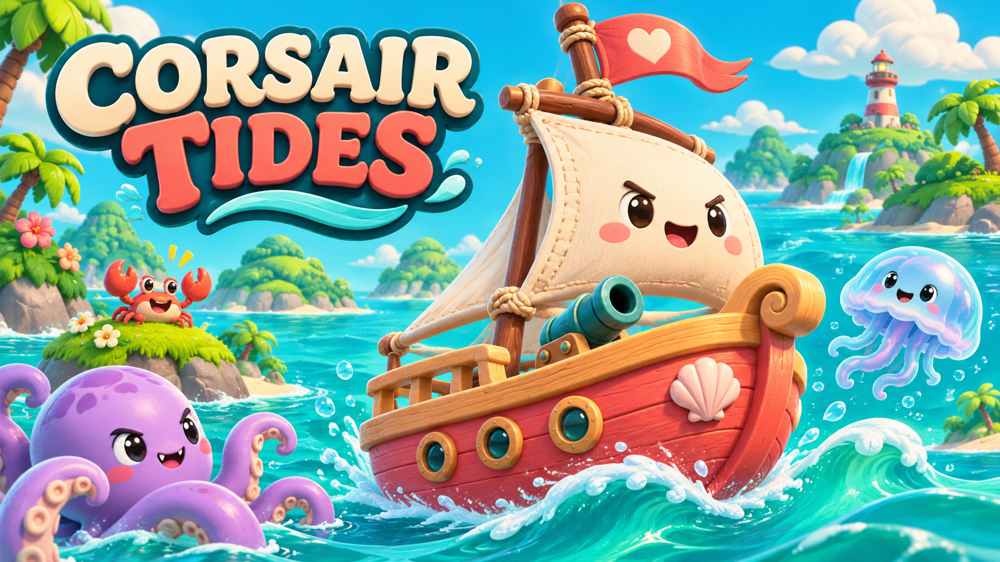

# Corsair Tides

A cheerful nautical survival game: sail a little boat, battle sea monsters, and build your own weapon combinations.

[Play in your browser](https://eric-schecter.github.io/corsair-tides/)

## How to Play

- **WASD / arrow keys:** Sail and turn. Weapons aim and fire automatically.
- **1–4 / cannon icons:** Switch unlocked main cannons. No ammo or reloading.
- **Upgrade cards / 1–3:** Choose weapons, abilities, and combinations.
- Collect experience, hull repairs, armor, and rare fireworks that activate on pickup.
- **Esc:** Pause. **M:** Toggle music.

## Development

Open `project.godot` in Godot **4.7.2**. Run `tools/export_web.sh` to build the web version; set `GODOT_BIN` if needed.

- `scenes/`, `scripts/`: Game scenes and logic.
- `assets/`: Audio and creature animation sheets.
- `web/`: Cover, loading page, and UI sounds.
- `tools/`: Music generation and web export.

Cover art was generated with AI. Gameplay art is drawn in code and cached into animation sheets. See [asset credits](docs/ASSETS.md).
